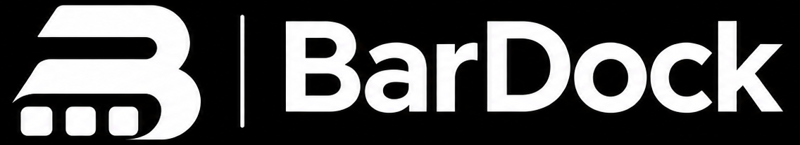
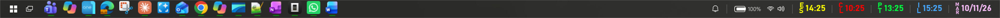

<p align="center">
  
</p>

<p align="center">
  <strong>Your desktop, your way.</strong>
</p>

<p align="center">
  <a href="LICENSE"></a>
  
  
</p>

<p align="center">
  
</p>

**BarDock** es una barra superior minimalista para Windows 11: tus iconos con magnificación
tipo macOS, relojes de varias zonas horarias, fecha, estado del sistema, bandeja nativa y vista
previa de las ventanas de cada aplicación. Sustituye la barra de tareas de Windows y se adapta a
cómo quieras trabajar: arriba o abajo, iconos centrados o a la izquierda, en español o inglés.

## Documentación

- **[Guía de instalación](docs/INSTALL.md)**: requisitos, instalación, actualización, desinstalación
  y problemas frecuentes.
- **[Manual de usuario](docs/MANUAL.md)**: todo lo que hace la barra, menús, relojes, ajustes y
  preguntas frecuentes.

## Características

- **Iconos con magnificación** estilo dock: crecen hacia dentro de la pantalla mientras el icono
  bajo el cursor no se mueve, y la línea de estado verde crece con él.
- **Ventanas por icono**: al pasar el ratón se listan las ventanas abiertas de la app; al hacer
  clic se trae **solo esa** al frente.
- **Barra de Inicio y vista de tareas** reales, sin la barra de Windows.
- **Bandeja nativa**: un chevron abre el panel real de iconos ocultos de Windows, con sus menús
  contextuales originales.
- **Relojes** de varias zonas con alias vertical configurable (`E`/`S`), tipografía, negrita,
  color por zona, tamaño e interlineado comunes, y **fecha** con el día de la semana.
- **Estado del sistema**: batería, red y volumen (clic y rueda para el volumen).
- **Personalización**: posición arriba/abajo, alineación, altura, tamaño/ampliación/separación de
  iconos, transparencia y **español/inglés**.
- **Sin dependencias**: instalador autocontenido; no hace falta .NET ni permisos de administrador.

## Instalar

Descarga `BarDockSetup.exe` de la sección **Releases** y ejecútalo. Los pasos detallados están en
la **[guía de instalación](docs/INSTALL.md)**.

- Instalación **por usuario** en `%LOCALAPPDATA%\Programs\BarDock` (sin administrador).
- Crea accesos directos en Inicio y, opcionalmente, en el escritorio.
- Se desinstala desde **Configuración → Aplicaciones → BarDock**.
- Instalación silenciosa: `BarDockSetup.exe /S`.

> Windows puede avisar de que el instalador no está firmado: **Más información → Ejecutar de todas
> formas**. Es un ejecutable propio, sin firma de código.

## Licencia

**MIT** — software libre y abierto: puedes usar, copiar, modificar, fusionar, publicar, distribuir,
sublicenciar y vender copias, conservando el aviso de copyright y la licencia. Consulta
[LICENSE](LICENSE).

## Ejecutar en desarrollo

```bat
run.cmd
```

o compila y ejecuta:

```bat
dotnet run --project BarDock.csproj
```

`publish.cmd` genera `dist\` (versión ligera, requiere el runtime .NET Desktop 8) y
`build-setup.cmd` genera `dist\BarDockSetup.exe` (autocontenido, con la app incrustada).

## Uso

| Acción | Resultado |
| --- | --- |
| Pasar el ratón por la barra | Los iconos se amplían; el icono bajo el cursor se queda quieto |
| Pasar el ratón por un icono abierto | Lista de **sus ventanas**; el clic trae **solo esa** al frente |
| Clic en el logo de Windows | Abre el **menú Inicio** (clic derecho: aplicaciones y configuración) |
| Clic en la vista de tareas | Abre **Win+Tab** (escritorios virtuales); se puede ocultar |
| Clic en el chevron de la bandeja | Abre el **panel nativo de iconos ocultos** de Windows |
| Clic en la campana | Centro de notificaciones de Windows |
| Clic en batería / red / volumen | Panel correspondiente (volumen: clic silencia, rueda ajusta) |
| Clic derecho en la barra | Añadir app, relojes y fecha, tamaños, posición, alineación, transparencia, idioma, sustituir la barra de Windows, inicio con Windows, recargar, editar JSON, salir |
| Arrastrar un `.exe` / `.lnk` / `.url` | Lo añade a la barra |

La primera vez se rellena con las apps **ancladas de verdad** a la barra de tareas (leídas de
`HKCU\Software\Microsoft\Windows\CurrentVersion\Explorer\Taskband`) y con las que estén abiertas.

### Barra de Windows

Con «Sustituir la barra de Windows» activado, la barra original se oculta mediante una **región
vacía** (`SetWindowRgn`), así que no se dibuja pero el shell conserva su bandeja. Al desactivarlo,
la barra vuelve y BarDock se coloca **junto** a ella para que sigas pudiendo usar su menú.

## Configuración

Los ajustes viven en `%APPDATA%\BarDock\settings.json` y se editan desde el menú contextual de la
barra (**Relojes y fecha**, **Altura**, **Posición**, **Alineación**, **Transparencia**,
**Idioma**…) o a mano y luego **Recargar**.

```jsonc
{
  "version": 5,
  "barHeight": 36,
  "iconSize": 26,
  "maxScale": 2.2,
  "spacing": 8,
  "topMargin": 0,
  "replaceTaskbar": true,
  "barPosition": "top",       // "top" o "bottom"
  "barOpacity": 0.9,          // 0.3 - 1.0
  "iconAlignment": "left",    // "center" o "left"
  "showTaskView": true,
  "renderMode": "hardware",   // "hardware" o "software" (mitad de memoria, algo mas de CPU)
  "language": "en",           // "es" o "en"

  "clockFontFamily": null,
  "clockFontSize": 17,
  "clockBold": false,
  "clockLetterSpacing": 0.95,

  "dateAlias": "",            // vacío = día de la semana (WED, MIÉ...)
  "dateColor": null,

  "items": [
    { "path": "shell:AppsFolder\\MSTeams_8wekyb3d8bbwe!MSTeams", "name": "Microsoft Teams" },
    { "path": "C:\\Ruta\\App.exe", "name": "Nombre opcional" }
  ],

  "clocks": [
    { "label": "Madrid",   "zone": "Romance Standard Time", "alias": "ES", "color": null },
    { "label": "Santiago", "zone": "Pacific SA Standard Time", "alias": "CL" },
    { "label": "Lisboa",   "zone": "GMT Standard Time", "alias": "PT" },
    { "label": "Tel Aviv", "zone": "Israel Standard Time", "alias": "IL" }
  ]
}
```

- `alias` es el texto vertical de 2-3 letras; si falta se deduce de la zona.
- `color` (por reloj o `dateColor`) acepta `#RRGGBB` o un nombre (`Gold`, `Tomato`…).
- La fecha usa el idioma de la barra: `WED` en inglés, `MIÉ` en español.

## Cómo está hecho

- **WPF / .NET 8**: ventana `WindowStyle=None` + `AllowsTransparency`, siempre visible con
  `Topmost` y oculta de Alt+Tab con `WS_EX_TOOLWINDOW`.
- **Magnificación**: gaussiana según la distancia horizontal del cursor, con muelle exponencial en
  `CompositionTarget.Rendering` (se detiene en reposo). La expansión se calcula centrada y cada
  contenedor se desplaza entero, de modo que el icono y su zona clicable coinciden siempre.
- **Barra de tareas**: `FindWindow("Shell_TrayWnd")` + **región vacía**; se restaura al salir.
- **Área de trabajo**: `SPI_SETWORKAREA` con `fWinIni = 0`; al cambiar alto o borde se recolocan
  las ventanas maximizadas (`ShowWindow`).
- **Bandeja**: el chevron invoca por UI Automation el panel nativo
  `TopLevelWindowForOverflowXamlIsland`.
- **Inicio / vista de tareas**: inyección de teclas (`SendInput`) sobre el shell real.
- **Iconos**: `shell:AppsFolder\<AUMID>` con `IShellItemImageFactory` para apps empaquetadas;
  `PrivateExtractIcons` → `IShellItemImageFactory` → `SHGetFileInfo` para el resto.

## Limitaciones

- Solo el **monitor principal**.
- No usa el *blur* real de DWM: la barra es translúcida, no acrylic.
- Las apps empaquetadas se lanzan por AUMID; si Windows cambia de versión, puede variar el icono.

## Diagnóstico

```bat
BarDock.exe --dump-icons
BarDock.exe --dump-windows
```

`--dump-icons` deja los iconos extraídos en `%TEMP%\barDock-icons`; `--dump-windows` deja en
`%TEMP%\barDock-windows.txt` las ventanas agrupadas por aplicación.
